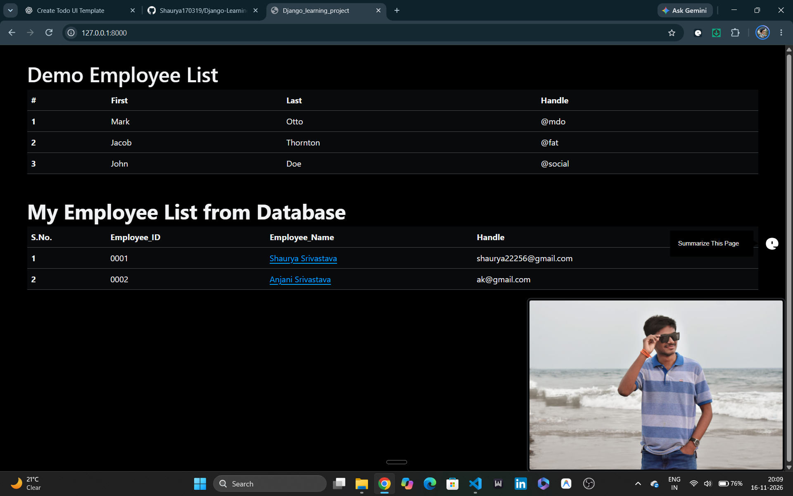
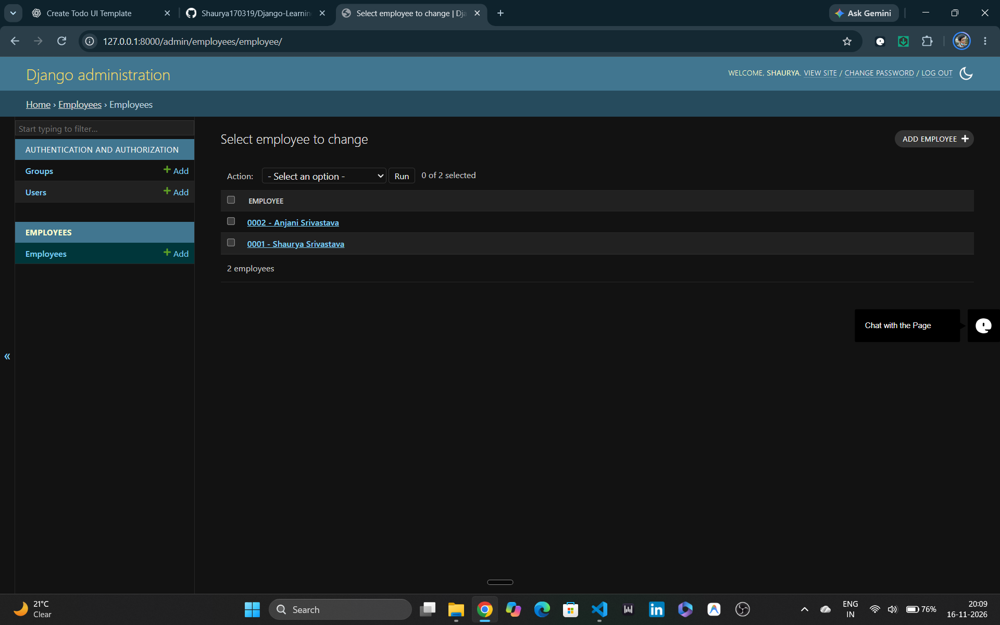
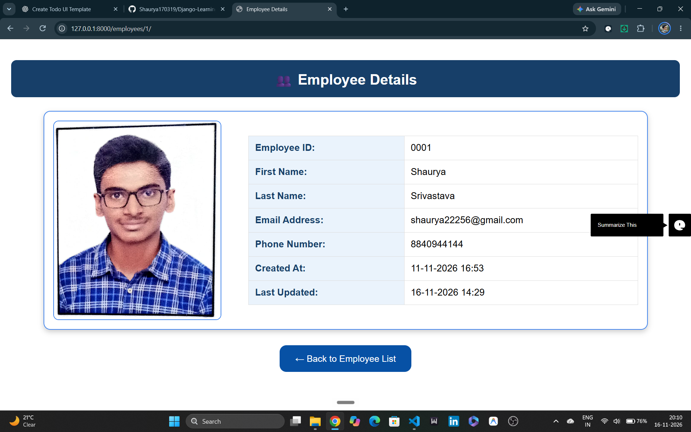

# Django Backend Development – My Learning Journey 🚀

## 📌 About This Project

This repository marks the beginning of my **Backend Development journey**, where I started learning Django and understanding how backend applications work.

I explored the fundamentals of Django, learned how to work with database models, and implemented functionality to store, retrieve, and display employee information from a database.

Through this project, I gained practical experience in connecting the frontend with the backend using Django.

## 🛠️ Technologies Used

- **Python** – Backend programming language.
- **Django** – Python web framework.
- **HTML** – Structure of web pages.
- **CSS** – Styling and designing web pages.
- **SQLite** – Database for storing employee records.

## 📚 What I Learned

### 1. Understanding Django Basics

- Introduction to Django and its architecture.
- Understanding Django projects and applications.
- Working with URLs, views, and templates.
- Understanding how requests and responses work.

### 2. Working with Models (models.py)

- Understanding Django models.
- Creating an Employee model.
- Defining database fields such as:
  - Employee ID
  - First Name
  - Last Name
  - Email Address
  - Phone Number
  - Employee Photo
  - Created At
  - Last Updated
- Understanding how Django models represent database tables.

### 3. Database Operations

- Storing employee information in the database.
- Fetching records using Django ORM.
- Passing database records from views to HTML templates.
- Displaying dynamic employee information on web pages.

### 4. Django Admin Panel

- Exploring the Django Admin interface.
- Managing employee records through the admin panel.
- Viewing and updating database entries.

### 5. Dynamic Employee Details Page

- Implementing an employee details page.
- Fetching individual employee records using their ID.
- Displaying employee information dynamically.
- Fetching and displaying employee photos from the database.

## 📸 Project Screenshots

### 1. Employee List

Displaying employee records fetched from the database in a dynamic HTML table.

### 2. Django Admin Panel

Managing employee records through Django's built-in administration panel.

### 3. Employee Details Page

Displaying complete employee information, including the employee photo, by fetching the corresponding record from the database.

## 🎯 Key Takeaways

This project helped me understand how backend development works in practice.

I learned how to:

- Create and manage Django models.
- Work with databases using Django ORM.
- Retrieve records from a database.
- Pass backend data to frontend templates.
- Display dynamic content using Django.
- Manage database records through Django Admin.

## 🚀 What's Next?

This is just the beginning of my backend development journey. I look forward to exploring more Django concepts, improving my database management skills, implementing CRUD operations, and building more dynamic web applications.

---

**Learning, Building, and Growing in Backend Development!** 💻